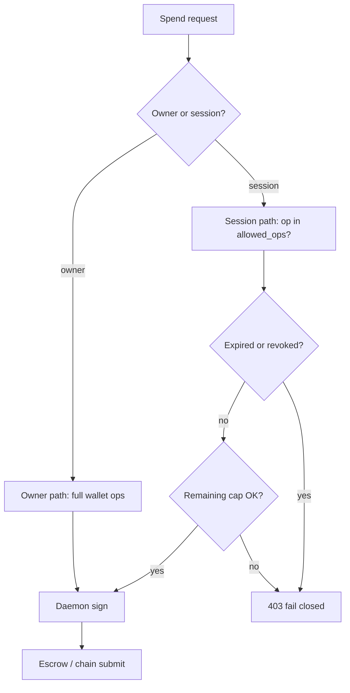

# Agent spend policy — API and CLI

Row: **AGENT-WALLET-AA-1** · Gitea [#1136](https://gitea.bubuit.net/oib/aitbc/issues/1136)

Design-only. Reuse existing routes before adding new ones. Amounts in **AIT**.

## Base paths

| Surface | Prefix / entry |
| --- | --- |
| Agent identity REST | `/v1/agent-identity` (`contexts/agent_identity/routers/agent_identity.py`) |
| Escrow (chain RPC) | blockchain-node escrow routes (CLI: `aitbc market escrow …`) |
| ZK receipt | `POST /v1/zk/receipt/verify` |
| Wallet daemon | `apps/wallet` HTTP (signing boundary — policy hook Phase A) |
| MCP | `mcp-server/aitbc_mcp_server.py` job submit flags |

## Existing identity routes (reuse)

Owner-gated mutators use `_require_owned_identity` (see #1070).

| Method | Path | Role today | Spend policy gap |
| --- | --- | --- | --- |
| POST | `/identities` | Create identity | — |
| GET | `/identities/{agent_id}` | Read | — |
| PUT | `/identities/{agent_id}` | Update | Owner |
| POST | `/identities/{agent_id}/deactivate` | Revoke identity | Coarse vs session revoke |
| POST | `/identities/{agent_id}/wallets` | Create wallet row | Sets `spending_limit`, `permissions` |
| GET | `/identities/{agent_id}/wallets` | List | — |
| GET | `/identities/{agent_id}/wallets/{chain_id}/balance` | Balance | Not owner-gated today |
| POST | `/identities/{agent_id}/wallets/{chain_id}/transactions` | Execute tx | Soft limit; permissions unused |
| GET | `/identities/{agent_id}/wallets/{chain_id}/transactions` | History | — |
| POST | `/identities/{agent_id}/wallets/{chain_id}/sign` | Sign message | No spend op taxonomy |
| DELETE | `/identities/{agent_id}/wallets/{chain_id}` | Delete wallet | Owner |
| GET | `/identities/{agent_id}/resolve/{chain_id}` | agent → address | **Use for escrow binding** |
| GET | `/address/{chain_address}/resolve/{chain_id}` | Reverse resolve | — |

Cross-chain and registry routes remain unchanged; spend policy does not replace
`CrossChainMapping`.

## Agent-coordinator coin requests (separate from spend sessions)

Hub **automatic coin grants** (WebSocket / `POST` registration path) stay in
`apps/agent-coordinator` (`coin_request_policy.py`). They use rolling
hourly/daily **faucet budgets** (`COIN_REQUEST_AUTO_BUDGET_*`, per-identity
first-grant rule) and do **not** replace coordinator **spend sessions** or
marketplace escrow caps.

| Concern | Enforced where | Notes |
| --- | --- | --- |
| Auto-approve coin request size / window budgets | agent-coordinator | Faucet onboarding; not GPU escrow |
| Session cap, expiry, `allowed_ops`, audit | coordinator-api `/spend-sessions` | Phase A; consumed on wallet execute |
| Escrow lock agent binding | coordinator + chain | Phase D; resolve API |

Operators tune both layers independently; see module docstring in
`coin_request_policy.py` and spend-session REST above.

## Proposed spend-policy routes (Phase A)

Extend agent-identity router (or nested `/spend-sessions`) — names are **draft**;
confirm against OpenAPI generator before implementation.

| Method | Path | Caller | Body / params | Behavior |
| --- | --- | --- | --- | --- |
| POST | `/identities/{agent_id}/spend-sessions` | Owner JWT | cap AIT, expiry, `allowed_ops[]`, optional chain_id | Create session credential (maps to `EscrowAllowance`) — **implemented** |
| GET | `/identities/{agent_id}/spend-sessions` | Owner | — | List active/revoked — **implemented** |
| POST | `/identities/{agent_id}/spend-sessions/{session_id}/revoke` | Owner | — | Immediate revoke — **implemented** |
| GET | `/identities/{agent_id}/spend-sessions/{session_id}` | Owner or session | — | Remaining cap, ops |
| POST | `/identities/{agent_id}/spend-sessions/{session_id}/consume` | Internal / agent | op, amount AIT, ref (escrow_id) | Reserve or record spend (atomic with DB) |

**Agent-facing execute path (preferred):** keep
`POST .../wallets/{chain_id}/transactions` but require valid `session_id` header
or body for agent-initiated spends; owner-initiated txs unchanged.

### Allowed operations (enum draft)

| Op | Meaning |
| --- | --- |
| `escrow.fund` | Lock buyer funds into job escrow |
| `escrow.settle` | Only via existing release/refund RPC after gates |
| `transfer.approved` | Explicit allowlist payee set (not generic transfer) |

No op for raw `withdraw` or `permissions.update` for session callers.

## Wallet daemon (internal contract)

Phase A adds a **policy check** API or shared library call before sign:

- Inputs: owner id, session id, op, amount AIT, chain_id, optional escrow ref
- Output: allow / deny with reason
- **Fail closed** if policy store unreachable (configurable only for break-glass with operator env — not default)

Do not expose daemon keys to coordinator; coordinator passes intent only.

## CLI (extend existing tree)

Verify real command tree before shipping; draft from #1136:

| Command | Status today | Target |
| --- | --- | --- |
| `aitbc market escrow create\|status\|release\|refund` | Live | Unchanged; use resolve for addresses |
| `aitbc agent-wallet balance\|stake\|rebalance` | **Simulated** | Wire to policy or mark deprecated |
| `aitbc wallet session create\|list\|revoke` | **Missing** | Phase A — owner only |
| `aitbc wallet session permissions` | **Missing** | Read-only for auditors |

Fund-moving and authorize commands require **explicit confirmation** flag.

## MCP

Today: job submit with `buyer_address`, `provider_address`, `zk_proof_required`.

Phase D (**implemented** on `main`):

- Optional `buyer_agent_id` / `provider_agent_id` on escrow create, coordinator payments, GPU purchase, `aitbc ai submit|pay`, `market run`, `market gpu quote|buy`
- Resolve to address via `GET .../resolve/{chain_id}`

## SDK

`coordinator_api/agent_identity/sdk/client.py` — add session methods mirroring
REST when implemented. Until then, document gap in client docstrings only (no
false “implemented”).

## EVM EIP-7702 (Phase C2 — optional)

Isolated CLI subcommands under `aitbc wallet delegation …` **only if** Phase C2
triggered:

- `status`, `authorize`, `revoke` (Sepolia)
- Never registered on native chain CLI tx builders

## Authorization summary diagram

## Related documents

- [`database.md`](database.md) — session tables
- [`implementation-plan.md`](implementation-plan.md) — Phase A/D

---

*Operator-owned row · AGENT-WALLET-AA-1 / #1136*
