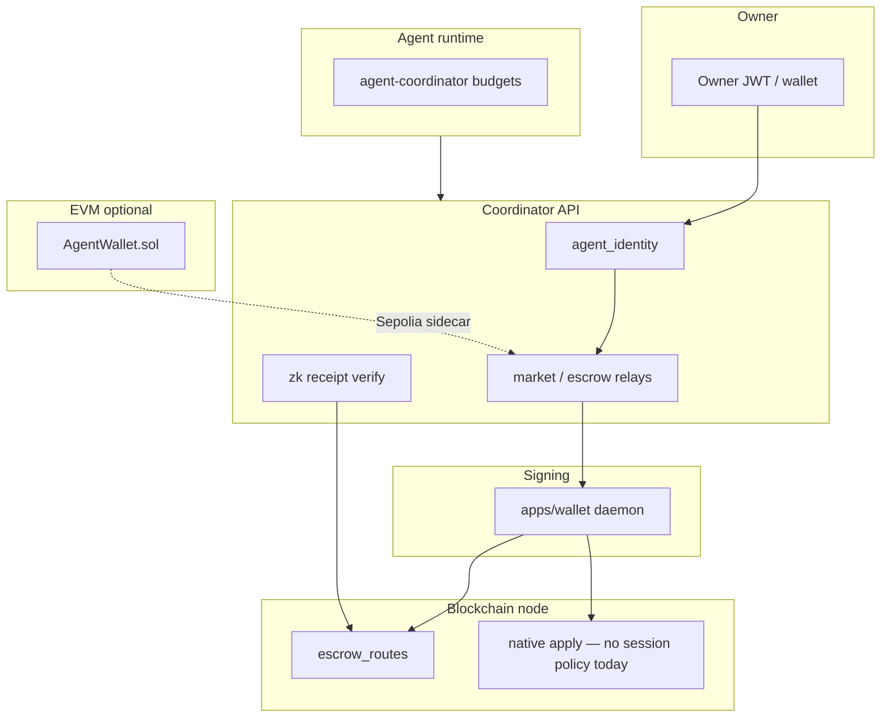
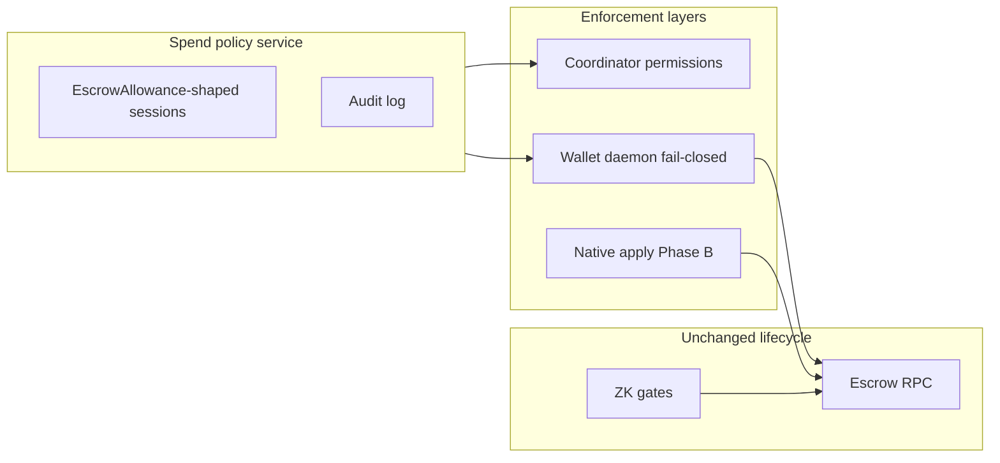
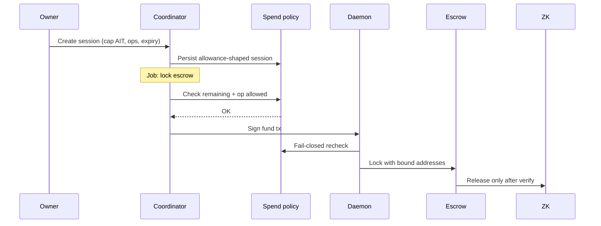

# Agent spend policy — architecture

Row: **AGENT-WALLET-AA-1** · Gitea [#1136](https://gitea.bubuit.net/oib/aitbc/issues/1136)

Design-only assessment. Staged delivery is in [`implementation-plan.md`](implementation-plan.md).

## Purpose

Give AI agents **permission to spend**, not **ownership of funds**, inside AITBC’s
real economics: **marketplace jobs → escrow lock → work → ZK/TEE gate → release**.
Native AIT and the wallet daemon are the default path; Ethereum EIP-7702 is an
**optional** adapter for EVM settlement on Sepolia, never part of native tx format.

## Fleet scope

Live AITBC runs on the **island fleet** only: **hub**, **hub1**, **node0**,
**node1**, **node2** — each with `/opt/aitbc`, chain data, and `aitbc-*` units
where that role requires them.

The **IDE localhost** is not an island node. It may hold `/opt/aitbc` (read,
worktrees, gitea commits) and staging under `~/windsurf/aitbc`, but it has **no**
production `data/` and **no** active AITBC services. Assessment evidence,
pytest, and service checks for this design belong on fleet hosts (for example
node0/node1 read-only, node2 for validator archives), not on localhost.

## Name disambiguation (mandatory in all docs)

| Name | Location | Role |
| --- | --- | --- |
| **AgentWallet (Solidity)** | `contracts/contracts/AgentWallet.sol` | Shared ERC20 micro-tx vault; lifetime `spendingLimit` |
| **AgentWallet (library)** | `aitbc/wallet/agent_wallet.py` | In-memory debit/credit; local `FROZEN` |
| **agent_wallets** | coordinator `agent_identity` ORM | Per-chain row: `spending_limit`, `permissions` |
| **agent_wallet** | coordinator `contexts/wallet` ORM | Encrypted key / KMS material |
| **GovernanceAgentWallet** | `contracts/governance/…` | DAO vote ACL — not payment policy |
| **Guardian (Python)** | `guardian_contract.py` et al. | **Prototype** — not apply/RPC wired |

## Current component map

## Target architecture (after Phase A–D)

One **spend policy** object modeled on `EscrowAllowance` (`aitbc/wallet/escrow.py`):
owner grants spender (session) a cap, expiry, and allowed operations.

## Per-component assessment

### Escrow and settlement (anchor)

| Item | Path | Today | Gap |
| --- | --- | --- | --- |
| Escrow RPC | `apps/blockchain-node/.../rpc/escrow_routes.py` | Buyer/provider **addresses** | No `agent_id` at lock |
| Escrow types | `aitbc/wallet/escrow.py` | `Escrow`, `EscrowAllowance` | Allowance not used as session policy |
| Payment escrow | `aitbc/crypto/payment_escrow.py` | Settlement helpers | Not unified with identity sessions |
| ZK release | `contexts/zk_applications`, miner router | Gates release | Independent of spend policy — keep |

### Coordinator agent identity

| Item | Path | Today | Gap |
| --- | --- | --- | --- |
| Owner check | `routers/agent_identity.py` (#1070) | JWT `sub` ↔ `owner_address` | Balance/history GETs not always gated |
| Wallets | `domain/agent_identity.py` `agent_wallets` | `spending_limit`, `permissions` | `permissions` not enforced on execute |
| Execute tx | `POST .../wallets/{chain_id}/transactions` | Soft limit in manager | `0` limit = unlimited; not atomic under load |
| Resolve | `GET .../resolve/{chain_id}` | agent → address | Needed for escrow binding (Phase D) |

### Wallet daemon (signing boundary)

| Item | Path | Today | Gap |
| --- | --- | --- | --- |
| Sign submit | `apps/wallet/` | Password/API auth | No spend policy check |
| Custody | `TOPOLOGY/2026-10-16-wallet-custody-inventory.md` | Single boundary | Must not add parallel keystore |

### Agent-coordinator

| Item | Path | Today | Gap |
| --- | --- | --- | --- |
| Budget / nonce | `coin_request_policy.py`, `nonce_store.py` | Agent budgets | Not same story as GPU marketplace spend |

### EVM vault

| Item | Path | Today | Gap |
| --- | --- | --- | --- |
| AgentWallet.sol | `contracts/contracts/AgentWallet.sol` | Lifetime cap, self-register | Owner ≡ agent; no period/allowlist |
| 7702 | — | None in product | Optional Phase C2 only |

### Python Guardian (demote)

| Item | Path | Docs claim | Reality |
| --- | --- | --- | --- |
| GuardianContract | `guardian_contract.py` | RPC enforcement | Not imported by apply/RPC |
| PersistentSpendingTracker | `persistent_spending_tracker.py` | Persistent caps | Second tracker; TOCTOU; cwd DB |
| AgentWalletSecurity | `agent_wallet_security.py` | Profiles | In-memory only |

## Transaction flow — agent funds GPU escrow (target)

## Native vs EVM adapter

| Concern | Native + coordinator | EVM (optional) |
| --- | --- | --- |
| Primary token flow | AIT, native escrow | ERC20 via vault |
| Session credential | DB + daemon (+ apply B) | Vault owner/agent split; optional 7702 delegate |
| Consensus | PBFT apply in Phase B | Ethereum mempool |
| Type-4 / 7702 | **Forbidden** in native txs | Sepolia only if Phase C2 triggered |

## Integration points (extend, do not duplicate)

- `aitbc/wallet/escrow.py` — canonical allowance semantics
- `apps/coordinator-api/.../agent_identity` — policy storage and API
- `apps/wallet/` — enforcement before sign
- `apps/blockchain-node/.../escrow_routes.py` — lock/release unchanged semantics
- `cli/aitbc_cli/commands/market/escrow.py`, MCP job submit — buyer/provider resolution

## Out of scope for this design row

- Consensus code changes (Phase B is a future row)
- EIP-4337 factory / paymaster (deferred)
- New fleet keystore or key rotation
- bc-3 work while parked (`tasks/HOLDS.md`)

## Related documents

- [`implementation-plan.md`](implementation-plan.md) — phases A–D
- [`security.md`](security.md) — threats and enforcement matrix
- [`api.md`](api.md) — HTTP/CLI surfaces
- [`database.md`](database.md) — persistence

---

*Operator-owned row · AGENT-WALLET-AA-1 / #1136*
