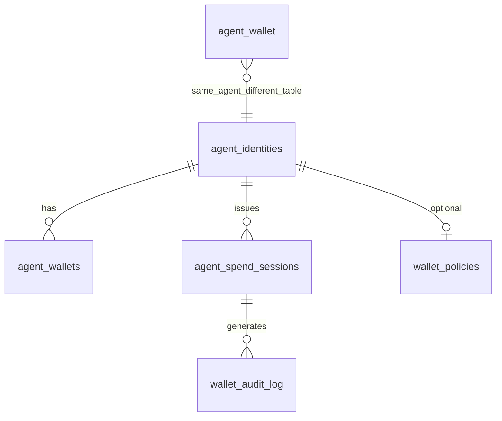

# Agent spend policy — persistence

Row: **AGENT-WALLET-AA-1** · Gitea [#1136](https://gitea.bubuit.net/oib/aitbc/issues/1136)

Design-only. **Alembic head** on coordinator-api at assessment time:
`d3e4f5a6b7c8` (`add_escrow_refund_relay_table`). Re-check `alembic heads`
before any migration row.

Amounts: store monetary fields as **Numeric** (existing pattern); display in **AIT**.

## Design principle

Map session spend policy to **`EscrowAllowance`** fields in
`aitbc/wallet/escrow.py`:

| Allowance field | Session policy meaning |
| --- | --- |
| `owner_id` | Policy owner (human / master identity) |
| `spender_id` | Agent or `session_*` id |
| `amount` / `used` / `remaining` | Cap in AIT |
| `expires_at` | Session TTL |
| `token` / `chain_id` | Asset and chain scope |
| `meta` | `allowed_ops`, escrow refs, audit pointers |

## Existing tables (reuse before creating)

### `agent_identities`

Model: `AgentIdentity` — `agent_identities`
Path: `contexts/agent_identity/domain/agent_identity.py`

| Column | Use for spend policy |
| --- | --- |
| `owner_address` | Owner for all sessions under agent |
| `status` | `REVOKED` / `SUSPENDED` → block new sessions |

### `agent_wallets` (identity context)

Model: `AgentWallet` — table **`agent_wallets`**

| Column | Today | Target |
| --- | --- | --- |
| `spending_limit` | Soft check on execute | Align with session cap or owner ceiling |
| `total_spent` | Increment on execute | Per-wallet rollup; sessions track `used` |
| `permissions` | Stored, **not enforced** | Enforce or migrate to session rows |
| `chain_id`, `chain_address` | Payment address | Escrow lock binding |

### `agent_wallet` (wallet / KMS context)

Model: `AgentWallet` — table **`agent_wallet`** (singular)

| Column | Role |
| --- | --- |
| `encrypted_private_key`, `kms_key_id` | Signing material — **never** in session tables |
| `wallet_type` | EOA vs smart_contract — relevant for Phase C |

**Consolidation (Phase A doc decision):** one logical wallet per `(agent_id, chain_id)`;
either deprecate duplicate semantics in docs or merge via migration row (operator approval).

### Escrow relay tables (unchanged)

Recent migrations: `escrow_relay`, `escrow_release_relay`, `escrow_refund_relay`
— job settlement stays; optional FK from session consume log to `job_id` / escrow id in meta only.

### Not authoritative for security

| Store | Path | Verdict |
| --- | --- | --- |
| Guardian SQLite | `~/.aitbc/guardian_contracts/` | Not validator consensus |
| `spending_tracker.db` | cwd-relative singleton | Do not use as cap source of truth |

## Proposed tables (Phase A migration — future row)

Names align with #1136 prompt; confirm no collision before `alembic revision`.

### `agent_spend_sessions`

One row per issued session credential.

| Column | Type | Notes |
| --- | --- | --- |
| `id` | string PK | `session_{uuid}` |
| `agent_id` | string indexed | FK logical to `agent_identities.agent_id` |
| `owner_address` | string | Denormalized for audit |
| `chain_id` | int | Scope |
| `cap_ait` | Numeric | Max spend |
| `used_ait` | Numeric | Monotonic |
| `allowed_ops` | JSON array | e.g. `escrow.fund` |
| `expires_at` | datetime nullable | |
| `revoked_at` | datetime nullable | |
| `created_at` | datetime | |

Indexes: `(agent_id, revoked_at, expires_at)`, `(agent_id, chain_id)`.

**Concurrency:** update `used_ait` with `UPDATE ... WHERE used_ait + :amt <= cap_ait`
rowcount check or SERIALIZABLE — no read-modify-write race.

### `wallet_policies` (optional owner defaults)

Owner-level defaults per agent (max concurrent sessions, default TTL, global daily cap).

| Column | Notes |
| --- | --- |
| `agent_id` | |
| `max_session_cap_ait` | Ceiling for any single session |
| `daily_cap_ait` | Rollup across sessions |
| `policy_json` | Allowlist payees, provider ids |

If omitted, encode defaults in `agent_wallets.spending_limit` only.

### `wallet_audit_log`

Append-only.

| Column | Notes |
| --- | --- |
| `id` | PK |
| `agent_id`, `session_id` nullable | |
| `event` | `session.create`, `session.revoke`, `spend.denied`, `spend.ok` |
| `amount_ait` nullable | |
| `op` | |
| `ref` | escrow_id, tx hash |
| `created_at` | |

No private keys, no session secrets in clear text — store session **id** only;
credential presented out-of-band (HMAC/JWT) per implementation row.

**Chain `escrow.buyer_agent_id` / `provider_agent_id` (Phase D):** when set via
direct RPC they are **caller-supplied labels** on the escrow row, not proof of
identity. Coordinator relay and payment paths validate against
`CrossChainMapping`; nothing in consensus or RPC should treat on-chain agent id
strings as authenticated identity without that binding path.

### Deferred tables (only if product requires)

| Table | When |
| --- | --- |
| `wallet_delegations` | Phase C2 EIP-7702 |
| `wallet_sponsorships` | Operator requests paymaster |
| `wallet_batches` | Batch GPU checkout |

## Native chain state (Phase B — not SQL)

Document in architecture, implement in consensus row:

- Per-account or per-session **spent** counter in chain state
- Version-height activation
- No duplicate SQLite on validators

## EVM (Phase C)

On-chain: `AgentWallet.sol` storage or delegate contract — off-chain indexer may
mirror to coordinator for UI; chain remains source of truth for EVM spends.

## Entity relationship (coordinator)

## Migration discipline

1. `cd apps/coordinator-api && alembic heads` — must be single head.
2. New revision after Phase A row approved; forward-only in prod.
3. Backfill: existing `agent_wallets.permissions` → default session or enforced inline.
4. Never store plaintext keys in new tables.

## Related documents

- [`api.md`](api.md) — REST mapping
- [`implementation-plan.md`](implementation-plan.md) — Phase A/B

---

*Operator-owned row · AGENT-WALLET-AA-1 / #1136*
