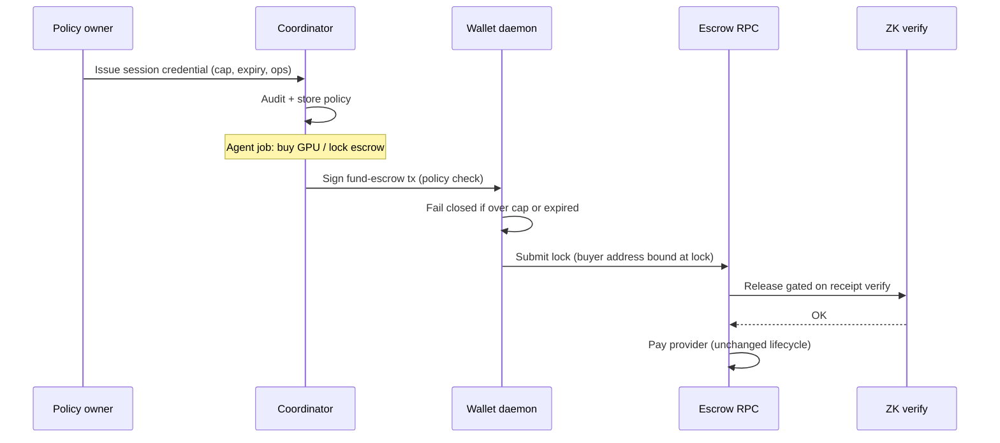
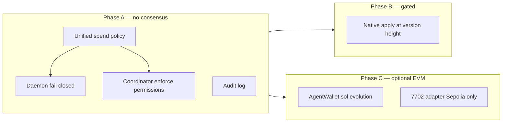

# Agent spend policy and session credentials — implementation plan

Row: **AGENT-WALLET-AA-1** · Gitea [#1136](https://gitea.bubuit.net/oib/aitbc/issues/1136)

This document is **design only**. It describes how AITBC should give **agents
permission to spend, not ownership of the wallet**, in terms that match the
fleet: **marketplace jobs, escrow, ZK-gated release, native AIT, and the wallet
daemon** — not a standalone Ethereum “account abstraction” product.

EIP-7702 appears here only as an **optional EVM adapter** where settlement
actually happens on Ethereum (Sepolia during development). It is never mixed
into the native transaction format.

**Amounts:** limits and caps in docs use **AIT** (1 AIT = 36,000,000 base units).

## Executive summary

| What AITBC already does well | What is missing |
| --- | --- |
| Escrow lifecycle + ZK/TEE gates before release | Agent spend not scoped to “fund escrow / pay within job” |
| Coordinator `agent_identity` owner checks (#1070) | `permissions` JSON not enforced on execute paths |
| Wallet daemon as signing boundary | No fail-closed spend policy before sign |
| `EscrowAllowance` (owner → spender, cap, expiry) in `aitbc/wallet/escrow.py` | Not wired as the canonical policy model across services |
| EVM `AgentWallet.sol` micro-tx vault | Owner ≡ agent EOA; lifetime cap only |
| Agent-coordinator budgets (`coin_request_policy`, nonces) | Not unified with marketplace GPU spend |

**Direction:** one **agent spend policy** model (session credentials + caps +
audit), enforced **first** at coordinator and wallet daemon, **then** on native
chain at a version height when a dedicated row is approved, **optionally** on
EVM via vault evolution or a small 7702 adapter if a concrete EVM path requires
it. Retire the fiction that Python Guardian modules are consensus-enforced.

**Explicitly deferred:** EIP-4337 factory, paymaster, and “OpenClaw AA wallet”
from `docs/releases/v0.13/v0.13.0_autonomous_economics_plan.md` unless the
operator adds a **subsidized EVM gas** requirement.

## Success criteria (AITBC-shaped)

Implementation is done when tests and ops can show:

- An agent with a session credential can **fund escrow and pay within policy**
  but cannot bypass escrow release or ZK gates.
- **Daily / per-tx caps in AIT** hold under concurrent requests (atomic
  accounting, not two SQLite trackers).
- **Expired or revoked** session fails before sign (daemon) and before
  settlement.
- Session credential is **not a mini-master**: cannot raise limits, spawn
  sessions, strip owner controls, or arbitrary withdraw.
- **Compromised session** cannot release escrow without passing existing
  receipt/ZK checks.
- Every authorize / revoke / spend attempt leaves an **audit** row.
- EVM type-4 / 7702, if enabled, affects **only** Sepolia EVM txs; native PBFT
  txs unchanged.

## Canonical policy model (reuse, do not reinvent)

Treat **`EscrowAllowance`** semantics as the template for session spend policy:

- **Owner** grants **spender** (agent session) a **cap** and **expiry**.
- Spender consumes allowance via allowed **operations** (mapped to marketplace:
  lock escrow, pay provider, not raw “transfer anywhere”).

Extend in place:

- `aitbc/wallet/escrow.py`, `aitbc/wallet/agent_wallet.py`, `errors.py`
- Coordinator `agent_identity` (`spending_limit`, `permissions`)
- `apps/wallet/` daemon checks before `sign_and_submit_transaction`
- Agent-coordinator **existing** budget/nonce policy — same numbers, one story

Avoid a large parallel **`aitbc/account_abstraction/`** tree until interfaces
prove insufficient; prefer extending the modules above.

## End-to-end flow (marketplace-first)

Native chain hardening (Phase B) adds the same rules at **apply time** so a
compromised coordinator cannot bypass the daemon.

## Operator prerequisites

1. **Owner vs agent signer:** adopt **policy owner + session credential** (required
   for the goal); document impact on Solidity self-register (#1101) on EVM.
2. **Escrow binding:** at lock, persist **payment addresses** and optionally
   `buyer_agent_id` / `provider_agent_id` so credential rotation does not orphan
   locks (`escrow_routes`).
3. **Guardian docs:** mark Python Guardian / `PersistentSpendingTracker` as
   **prototype, not enforced** until wired or removed from security claims.
4. **Phase B:** separate Gitea row + version-height approval (`bc-3` and
   `HOLDS.md` still apply).

## Phase A — Policy, daemon, coordinator (default first ship)

**Goal:** Real enforcement without consensus changes.

### Work

| Area | Action |
| --- | --- |
| Policy schema | Owner, session id, cap (AIT), expiry, allowed ops (escrow fund, approved settle), revoked |
| Coordinator | Enforce `permissions`; unify `agent_wallets` vs `agent_wallet` ORM story in `database.md` |
| Daemon | Fail-closed check before every spend sign; owner auth unchanged |
| Agent-coordinator | Align session caps with `coin_request_policy` / nonce replay rules |
| CLI/MCP | Wire `aitbc agent-wallet` or mark **simulated** in help and MCP descriptions |
| Docs | Demote Guardian “implemented on RPC” claims |
| Audit | `wallet_audit_log` (or equivalent) for issue/revoke/spend |

### Dependencies

- Assessment docs aligned (#1136).
- Alembic only after real head survey (`database.md`).

### Tests (extend)

- `apps/agent-coordinator/tests/test_agent_auth.py`
- `tests/cli/test_commands_wallet.py`
- `tests/unit/test_payment_escrow.py` (allowance semantics)
- Concurrent cap, expired session, revoked session, fail-closed when policy store unavailable

### Deploy

- Coordinator + wallet daemon rolling restart (fleet restart rule; ledger on #1136).
- **No** validator consensus change.

### Exit

- API authorization vs **intended** chain authorization documented per endpoint.
- Marketplace path: agent funds escrow within cap; cannot skip ZK release.

---

## Phase B — Native chain enforcement (consensus-adjacent, gated row)

**Goal:** Validators agree on spent budget; mempool/apply reject violating native
txs.

### Work

- Version-height gated apply plugin: session policy on native `TRANSFER` (and
  types needed for escrow funding only — minimal surface).
- Single **chain spent ledger** (no authoritative dual SQLite on validators).
- Reserve-then-commit or single apply mutation for concurrency.

### Not in scope for first B slice

- Arbitrary contract calls on native chain.
- Mixing EVM authorization lists into native tx format.

### Tests

- `tests/unit/test_wallet.py`, `tests/unit/test_transaction_service.py`
- Replay (chain id + account nonce), concurrent daily cap, policy down → reject

### Deploy

- One validator at a time; operator-approved row; quote go in issue ledger.

### Exit

- Same success criteria as Phase A, but violation rejected **on chain** even if
  daemon and coordinator are bypassed.

---

## Phase C — EVM settlement (optional, Sepolia only)

**Trigger:** Phase A documents a **concrete** requirement that agents must call
**specific EVM contracts** on Sepolia beyond “ERC20 micro-tx via vault.” If spend
is only native AIT + existing escrow, **skip Phase C** or limit to vault
upgrades.

### C1 — Vault evolution (preferred before 7702)

Extend `contracts/contracts/AgentWallet.sol`:

- Distinct **policy owner** vs **agent** (undo owner≡agent where product requires)
- Period caps, recipient allowlist, purpose length bound
- Map to marketplace “micro-tx to approved payee”

Fuzz: `contracts/test/fuzz/AgentWallet.t.sol`.

### C2 — EIP-7702 adapter (only if C1 insufficient)

Isolated module (e.g. under `aitbc/crypto/` or `contracts/` scripts — name at
implementation row):

- Authorization tuple, delegation designator, type-4 build/simulate/estimate
- Revocation by re-delegation; chain id + auth nonce validation
- **web3 / eth-account only**; Sepolia first; no mainnet before P5-style review

**7702 vs 4337:** use 7702 for “same EOA, limited code”; do **not** revive v0.13
4337 factory/paymaster without operator requirement for subsidized gas.

### Exit

- Unauthorized delegation rejected; revocation works; failed EVM tx does not
  write false settlement in coordinator.
- Native txs still contain **no** type-4 fields.

---

## Phase D — Marketplace binding (parallel with A, completes integration)

Can run alongside Phase A once policy schema is stable.

| Item | Action |
| --- | --- |
| Escrow lock | Resolve `agent_id` → buyer payment address; bind ids at lock |
| GPU / jobs | CLI/MCP `buyer_address` / `provider_address` via resolve API |
| Settlement | No new path around escrow; ZK `/v1/zk/receipt/verify` and miner gates unchanged |

Tests: `apps/blockchain-node/tests/contracts/test_escrow.py`, escrow integration
cases from #1136 prompt.

---

## Security validation gate (before mainnet / v1 EVM)

Cross-cutting review after A (+ B if shipped) and any C:

- Threat walkthrough in `security.md` (session compromise, replay, malicious
  delegation target, relayer abuse if C2, settlement manipulation).
- Negative matrix: invalid auth, wrong chain, bad nonce, limit breach, owner
  recovery, escrow integration.
- Confirm **critical caps** are on-chain in Phase B and/or EVM vault/delegate,
  not coordinator-only.

Block mainnet EVM delegation until operator sign-off.

---

## Native vs optional EVM adapter (short table)

| Concern | Phase A/B (native product) | Phase C (EVM only) |
| --- | --- | --- |
| Job payment story | Escrow + ZK | Same; EVM only if rail settles on Sepolia |
| Session credential | Coordinator + daemon (+ apply in B) | Plus delegation if C2 |
| Caps | AIT, per-tx/daily | Vault or delegate module |
| Gas | Native AIT fees | Agent or relayer; paymaster **deferred** |
| PBFT | Apply reject in B | N/A |

---

## Follow-on rows (register after operator approves plan)

| Example id | Phase |
| --- | --- |
| AGENT-SPEND-A-1 | Phase A + D |
| AGENT-SPEND-B-1 | Phase B (consensus) |
| AGENT-EVM-VAULT-1 | Phase C1 |
| AGENT-EVM-7702-1 | Phase C2 (only if triggered) |

**AGENT-WALLET-AA-1** remains docs-only until the five `docs/account-abstraction/`
files are verified.

## Complexity (rough)

| Phase | Size | Risk |
| --- | --- | --- |
| A + D | Medium | Low–medium |
| B | Large | **High** (consensus) |
| C1 | Medium | Medium |
| C2 | Large | High (optional) |

## Source anchors (`origin/main`)

- `aitbc/wallet/escrow.py` — `EscrowAllowance`
- `apps/wallet/` — signing boundary
- `apps/coordinator-api/.../agent_identity/`
- `apps/agent-coordinator/.../coin_request_policy.py`, `nonce_store.py`
- `apps/blockchain-node/.../rpc/escrow_routes.py`
- `contracts/contracts/AgentWallet.sol`
- `apps/blockchain-node/.../guardian_contract.py` (prototype only)

## Related docs

| File | Role |
| --- | --- |
| `architecture.md` | Components and escrow-first diagrams |
| `security.md` | Threat model and enforcement matrix |
| `api.md` | Issue/revoke session, resolve address, audit |
| `database.md` | Policy tables aligned with `EscrowAllowance` |

---

*Operator-owned row · AGENT-WALLET-AA-1 / #1136 · worktree `aa1136`*
