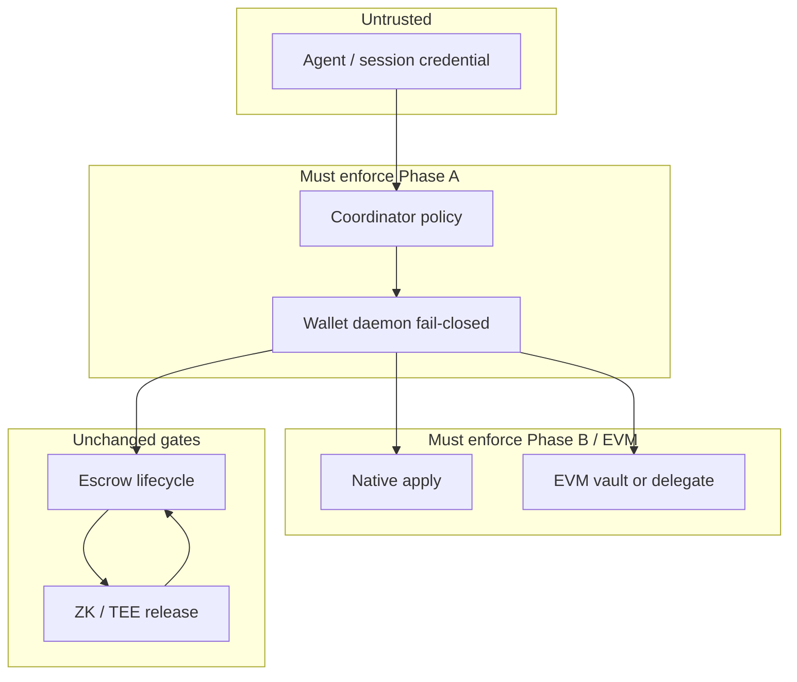

# Agent spend policy — security

Row: **AGENT-WALLET-AA-1** · Gitea [#1136](https://gitea.bubuit.net/oib/aitbc/issues/1136)

Companion: [`architecture.md`](architecture.md), [`implementation-plan.md`](implementation-plan.md).

## Security goal

A compromised or misconfigured **agent** must not gain **owner-equivalent** power:
no arbitrary withdraw, no limit escalation, no bypass of **escrow** or **ZK release**.

## Trust layers (target)

## Enforcement matrix (today vs target)

| Control | Coordinator API | Wallet daemon | Native apply | EVM vault | Notes |
| --- | --- | --- | --- | --- | --- |
| Owner-only admin | Partial (#1070 on mutating identity/wallet ops) | Owner unlock | N/A | Owner on withdraw/limit | Some GETs ungated |
| Per-tx cap (AIT) | Soft DB (`spending_limit`) | **None** | **None** | Lifetime only on Sol | `0` = unlimited in DB |
| Daily/period cap | Guardian lib only | **None** | **None** | **None** | Not consensus |
| Allowed operations | `permissions` **unused** | **None** | **None** | Micro-tx only | Must map to escrow fund, etc. |
| Session expiry | **None** | **None** | **None** | **None** | Use `EscrowAllowance.expires_at` pattern |
| Revocation | Identity deactivate | **None** | **None** | `deactivateAgent` one-way | Three different meanings |
| Fail closed | **No** (unprotected agent OK in guardian) | **No** | **No** | Reverts on chain | Target: fail closed |
| Concurrent cap atomicity | **No** | **No** | **None** | Sequential nonce in contract | No dual SQLite authority |
| Escrow bypass | ZK/miner gates on release | N/A | N/A | N/A | **Keep** — policy sits before lock/fund |
| Audit trail | Partial logs | **None** | Chain tx log | Events | Target: `wallet_audit_log` |

**Rule:** Any claim “enforced by Guardian” in legacy docs is **false** until wired to
apply/RPC or removed. See `docs/contracts/guardian.md`, `docs/security/SECURITY_AGENT_WALLET_PROTECTION.md` — treat as **aspirational** until Phase A doc pass.

## API-level vs chain-level authorization

| Layer | What it proves | Sufficient alone? |
| --- | --- | --- |
| JWT + owner check | Human owns identity row | No for spend caps |
| Coordinator policy check | Service agrees to request | No if daemon/coordinator compromised |
| Daemon fail-closed | Key use matches policy | Strong for hosted keys; still need B for native txs signed elsewhere |
| Native apply (Phase B) | Validators reject bad tx | **Required** for trustless native spend |
| EVM contract / delegate | On-chain revert | Required for Sepolia EVM path |

Document every endpoint with which layers apply.

## Session credentials (must not be mini-master)

Mandatory properties (from #1136 implementation spec):

1. Cannot change own permissions or spending limits.
2. Cannot authorize additional sessions.
3. Cannot remove owner controls or multisig policy.
4. Cannot withdraw arbitrary funds — only **allowed ops** within cap (e.g. fund named escrow).
5. Owner retains revoke and emergency stop outside session scope.

## Threat model

| Threat | Current exposure | Mitigation (phased) |
| --- | --- | --- |
| Agent key compromise | Full remaining vault / DB “limit” if enforced | Phase A ops allowlist + cap; B on-chain; short TTL sessions |
| Session key compromise | N/A (no sessions) | Cap + expiry + revoke; no mini-master rules |
| Coordinator compromise | Forges tx requests if daemon signs blindly | Daemon fail-closed; B validates on chain |
| Replay | Chain nonce (native); guardian local nonce buggy | Chain id + account nonce; drop guardian nonce authority |
| Concurrent limit bypass | TOCTOU in two SQLite trackers | Single policy store with reserve/commit |
| Malicious delegation target (7702) | N/A | Allowlist implementation address; Sepolia tests |
| Delegation replacement | N/A | Owner-only authorize; audit |
| Relayer abuse (if sponsorship) | N/A | Deferred with 4337/paymaster |
| Settlement manipulation | Escrow address swap | Bind addresses at lock; resolve API |
| Griefing deposit to agent vault | Anyone can `deposit` on Sol | Document; optional pull model in C1 |
| Unbounded `purpose` / tx array (Sol) | Storage grief | Length limits in C1 |

## Revocation semantics (three operations — do not conflate)

| Operation | Effect |
| --- | --- |
| Revoke **session credential** | Stops new spends under that session id |
| **Deactivate** agent wallet row / Sol agent | Stops new micro-tx; owner may withdraw |
| Clear **7702 delegation** (Phase C2 only) | Removes EOA code attachment on Ethereum |

## Guardian and PersistentSpendingTracker

**Assessment finding:** not a security boundary today.

- Do not rely on `persistent_spending_tracker.py` against a compromised coordinator.
- Critical caps must live in **daemon + apply (B) + EVM vault/delegate**, not host SQLite alone.
- If Guardian remains as simulator, label it offline-only in docs.

## ZK and escrow (unchanged trust model)

Spend policy **must not** short-circuit:

- `POST /v1/zk/receipt/verify`
- Miner / infrastructure gates before escrow release

Session credentials may **fund** escrow; **release** still follows existing rules.

## Test themes (carry to implementation rows)

Invalid auth, wrong chain id, bad nonce, expired/revoked session, unauthorized
contract/selector, limit violation, concurrent spend, replay, failed tx, gas-limit
breach, delegation replacement, emergency revocation, owner recovery, escrow
integration, compromised-session negatives.

## Related source files

- `aitbc/wallet/escrow.py` — `AllowanceExceededError`
- `apps/coordinator-api/tests/test_agent_identity_owner_check.py`
- `contracts/test/fuzz/AgentWallet.t.sol`
- `apps/blockchain-node/tests/test_guardian_contract.py` (library behavior only)

## Sepolia AgentWallet C1 rehearsal (#1143 / #1149)

Two Sepolia deployments are recorded in `contracts/deployments-agent-wallet-sepolia.json`:

| Address | Git | Managed registration |
|---------|-----|----------------------|
| `0x2F66f3eb7e6E31aa8A9Bdbb60f557854FBb9ad5e` | `c610d0f10` | **No agent consent** (1149B squatter risk — legacy rehearsal only) |
| `0x5e595F5112450276980958e3e197F0307aa371c5` | `1ff11a641` | **`proposeManagedAgentRegistration` + `acceptManagedAgentRegistration`** (#1149) |

**Mainnet v1** must ship the consent API (`1ff11a641` lineage), not the pre-consent
bytecode at `0x2F66f3…`. For new Sepolia rehearsal, prefer **`0x5e595F…`**.

---

*Operator-owned row · AGENT-WALLET-AA-1 / #1136*
